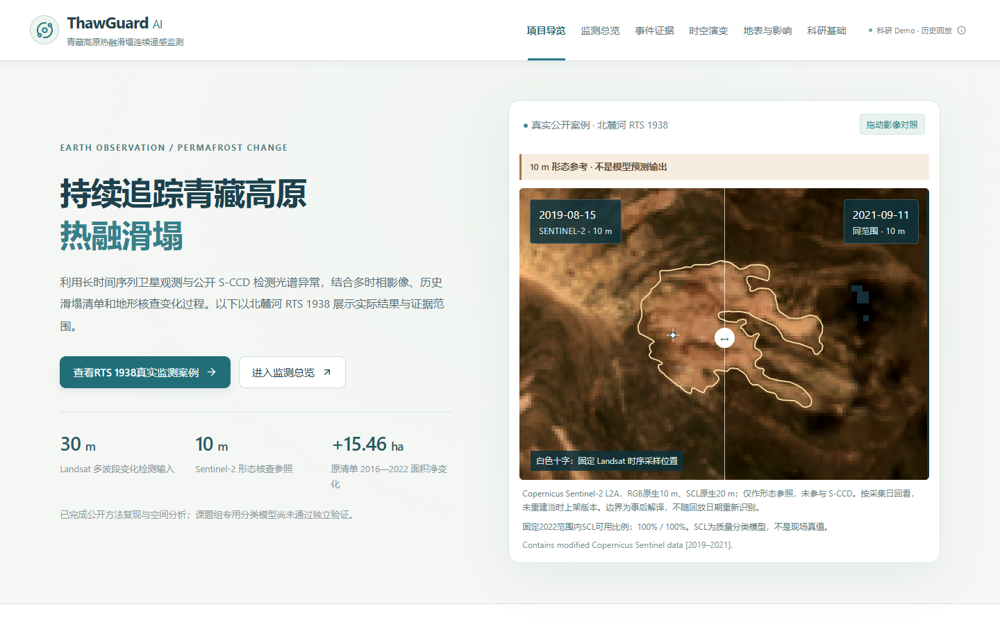

# ThawGuard AI

青藏高原热融滑塌连续观测与事件证据原型。面向科研判读人员，以 **RTS 1938** 核对卫星变化、历史边界与环境背景，记录判断依据并导出可复核报告。当前为历史科研核查 Demo，不提供灾前预测或正式预警。

**[下载完整离线演示包](https://github.com/shixuemin06-netizen/ThawGuard-AI/releases/download/v7-final/ThawGuard_v7_final_release.zip)** · [全部 Release 文件](https://github.com/shixuemin06-netizen/ThawGuard-AI/releases/tag/v7-final) · [单文件 HTML](https://github.com/shixuemin06-netizen/ThawGuard-AI/releases/download/v7-final/index.html)



## 离线运行，无需安装开发环境

1. 下载上面的 ZIP，**完整解压**。
2. 用桌面 Edge 或 Chrome 双击 `index.html`。前端、25组数据资源和28组图像均已内嵌，不需要联网、API Key、npm 或 Python。GitHub 的源码浏览页不会运行交互 HTML。
3. 如果单位浏览器限制 `file://`，Windows 双击 **`Start-Offline.cmd`**。它使用系统自带 PowerShell/.NET，仅在 `127.0.0.1:8017` 提供此 HTML 并打开浏览器，无需管理员权限或额外服务。保持窗口打开，关闭窗口或 Ctrl+C 停止。

推荐桌面1440 × 900。人工意见保存在本机当前浏览器，协作请导出报告或 JSON。外部论文、产品和数据源链接需联网，核心演示不依赖这些链接。

端口冲突时，在解压目录运行命令，自动选择空闲本机端口：

```powershell
powershell.exe -NoProfile -ExecutionPolicy Bypass -File .\Start-Offline.ps1 -Port 0 -OpenBrowser
```

macOS/Linux 可直接用浏览器打开 HTML；已有 Python 或 Node 时也可选用 `python -m http.server 8000 --bind 127.0.0.1` 或 `node serve.mjs`，再打开 `http://127.0.0.1:8000/`。不会擅自更改用户单位的浏览器策略。

## 三分钟完成一次核查

首页 → 查看RTS 1938真实监测案例 → 拖动两期影像 → 回到首次检出前 / 加入首次检出观测 → 检查地表与影响 → 导出当前判读说明。

10 m Sentinel-2 是形态参照，变化检测使用30 m Landsat。该像元估计变化日2020-09-29，首次检出依赖2020-11-24观测，56天是采集日期间隔，不是预警提前量。没有独立证据时可保留“证据不足”的判断。

这套流程支持核对“哪里出现什么光谱变化、何时具备检出依据、还缺什么资料”，尚未证明区域RTS分类精度、业务时效或实际管理收益。面积和设施间距不直接等于植被损失、碳排放或失效概率。

## 仓库内容

```text
index.html                     冻结终稿，直接离线运行
Start-Offline.cmd / .ps1        Windows系统自带服务入口
src/observatory-v7/            可编辑前端源码
public/data/ public/images/    前端构建输入
scripts/                       公开数据处理、构建与检查脚本
data/raw/ data/processed/      保留的公开输入和派生结果
research/                      公开产品目录和跨清单核对输入
docs/                          数据AI声明、署名、验证计划与复现说明
media/ examples/ qa/           实际截图、导出样例与验收记录
deliverables/observatory-v5,v6/ 科学哈希检查用历史基线
```

没有团队原始PPT、未发表算法参数、私有样本或账户凭证。原生窗口、产品目录和像元记录已保留，不是所有完整卫星场景。独立源码ZIP提供同一套公开工程材料。

## 开发与科学复算

**日常演示不需要这些步骤。** 修改前端时，安装Node22+和Python，首次安装依赖需要联网：

```powershell
npm ci
npm run dev
npm run build:final
```

`/dev.html` 是源码开发入口；新构建输出到 `deliverables/ThawGuard-AI/index.html`。根目录 `index.html` 是冻结快照。Python科研复算还需安装requirements中的依赖，未捆绑跨平台Node/Python本体与全部第三方依赖，因此不声称科研环境首次安装也可完全离线。**演示本身已完整自包含。** 详见[复现范围](docs/REPRODUCIBILITY.md)。

## 方法、署名与验证

公开S-CCD分析持续光谱结构变化。地形、影像和公开清单辅助专业判读。热融滑塌专用识别能力尚待独立验证。

CCDC来自Zhu & Woodcock（2014）；S-CCD来自Ye、Rogan、Zhu与Eastman（2021）；本次使用Su Ye公开的pyxccd1.1.0默认实现。团队两份科研材料提供研究问题、前期工作记录和路线；本次公开复现不能替代团队专用模型或独立验证成果。

Edge/Chrome在同一台Windows各通过113项离线断言，117项数据/方法完整性检查通过，源码重建与冻结HTML逐字节一致。第二台实体设备和真实公众三分钟理解度仍待实测，不把双浏览器当作双机。GitHub下载后的验收另见发布记录。

[数据与AI声明](docs/DATA_AND_AI.md) · [90天计划](docs/VALIDATION_90_DAYS.md) · [来源署名](docs/ATTRIBUTION.md) · [验收](docs/VALIDATION_REPORT.md) · [发布记录](docs/PUBLICATION.md) · [权利说明](RIGHTS.md)

第三方数据与软件按各自许可署名。本次没有擅自为原创代码新增统一开源许可证；公开仓库不等于全部内容可无条件再许可。
